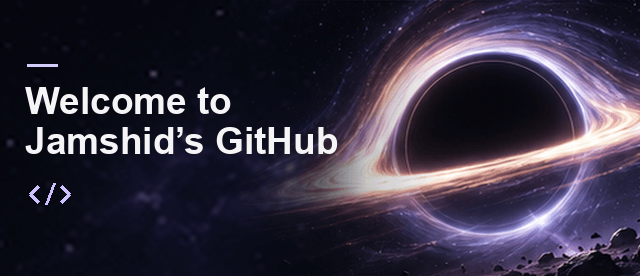
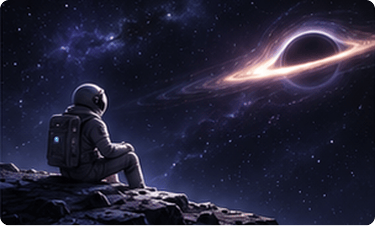
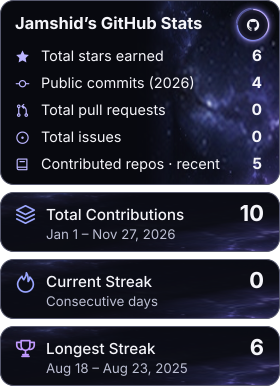
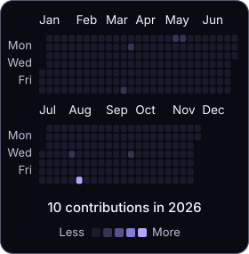

<picture>
  <source media="(min-width: 1012px) and (prefers-reduced-motion: no-preference)" srcset="./assets/animations/black-hole-orbit.png">
  <source media="(min-width: 1012px)" srcset="./assets/black-hole-banner.png">
  <source media="(prefers-reduced-motion: no-preference)" srcset="./assets/animations/black-hole-orbit-mobile.png">
  
</picture>

  <a href="https://github.com/jamshid-muxsinov"><picture><source media="(min-width: 1012px)" srcset="./assets/icons/github.svg"></picture></a>
  <a href="https://www.linkedin.com/in/jamshid-muxsinov-79b287373/"><picture><source media="(min-width: 1012px)" srcset="./assets/icons/linkedin.svg"></picture></a>
  <a href="https://t.me/tasheet"><picture><source media="(min-width: 1012px)" srcset="./assets/icons/telegram.svg"></picture></a>
  <a href="./selected-work.md"><picture><source media="(min-width: 1012px)" srcset="./assets/icons/portfolio.svg"></picture></a>
  <a href="mailto:jmuxsinovjj@gmail.com"><picture><source media="(min-width: 1012px)" srcset="./assets/icons/email.svg"></picture></a>

### <picture></picture>

  <picture>
    <source media="(min-width: 1012px) and (prefers-reduced-motion: no-preference)" srcset="./assets/animations/astronaut-space.png">
    <source media="(min-width: 1012px)" srcset="./assets/astronaut-space.png">
    <source media="(prefers-reduced-motion: no-preference)" srcset="./assets/animations/astronaut-space-mobile.png">
    
  </picture>
  Hi, I’m <strong>Jamshid</strong>, a software engineer. I build Python services, web interfaces, and mobile apps.

In my logistics simulator, a shipment gets held at customs. Students can wait, call a broker, or try another route while their instructor follows the session.

  <picture></picture> &nbsp;Backend services and APIs 
  <picture></picture> &nbsp;Telegram bots and mini apps 
  <picture></picture> &nbsp;Offline-first mobile development 

### <picture></picture>

  <picture></picture>
  <picture></picture>
  <picture></picture>
  <picture></picture>
  <picture></picture>
  <picture></picture>
  <picture></picture>
  <picture></picture>
  <picture></picture>
  <picture></picture>
  <picture></picture>
  <picture></picture>
  <picture></picture>
  <picture></picture>

### <picture></picture>

<a href="./assets/stats/summary.md"><picture>
  <source media="(min-width: 1012px) and (prefers-reduced-motion: no-preference)" srcset="./assets/stats/statistics-motion.svg">
  <source media="(min-width: 1012px)" srcset="./assets/stats/statistics.svg">
  <source media="(prefers-reduced-motion: no-preference)" srcset="./assets/stats/statistics-mobile-motion.svg">
  
</picture></a>

### <picture></picture>

<a href="https://github.com/jamshid-muxsinov?tab=overview#js-contribution-activity-description"><picture><source media="(min-width: 1012px)" srcset="./assets/stats/contributions.svg"></picture></a>
