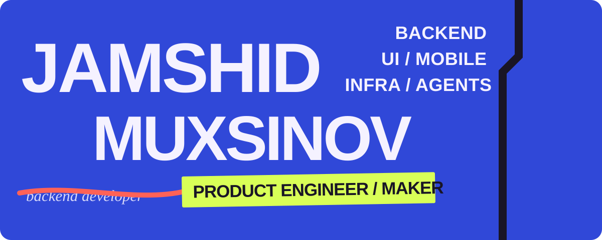
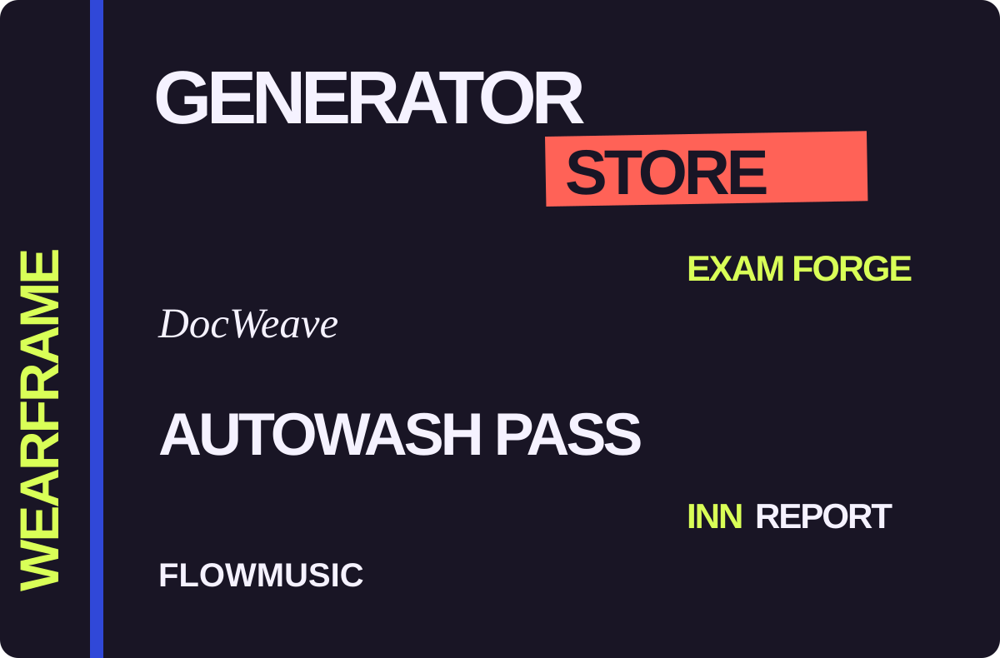
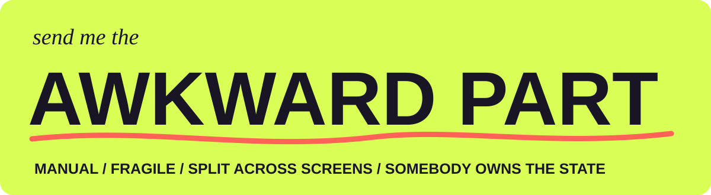

  

I build the whole awkward loop: the service, the screen beside it, the automation behind it, and the fallback for the day one of them lies.

The work keeps changing shape. That is usually the point.

### [BURGUT CARGO ↗](https://github.com/jamshid-muxsinov/burgut-cargo)

Cargo, warehouses, trucks, public tracking, Excel, realtime updates, and a Telegram bot all arguing over the same state. Django is the center; the hard part is keeping every edge honest.

> [**SOREX PROJECT ↗**](https://github.com/jamshid-muxsinov/sorex-project) is another pass through logistics: role-heavy operations, imports and exports, scheduled work, live notifications, and bot surfaces. It is not hidden just because a newer pass exists.

**[SIM—SOREX ↗](https://github.com/jamshid-muxsinov/sim-sorex)** cuts the domain into a classroom: seeded logistics scenarios, student/teacher roles, and Socket.IO events running through Express, Prisma, and Next.js.

  <a href="https://github.com/jamshid-muxsinov/weconstruct-website"><strong>WECONSTRUCT ↗</strong></a> 
  A FastAPI public site and operations surface sharing products, projects, leads, notes, assignments, Telegram, and Google Sheets. 
  Two deployable faces; one PostgreSQL core.

  

  

**Wearframe** sends a garment through a tracked AI job, swaps between generation providers, stores the artifacts, and returns live status to the gallery.

  <strong>GENERATOR STORE</strong> 
  Astro SSR + Django/DRF for a bilingual industrial catalog. CMS, categories, products, cart, and lead paths fail independently instead of turning one dead API into a dead storefront.

**AutoWash Pass** has one timed wash session and two Android roles. A client creates a rotating QR; a physical terminal scans it; FastAPI keeps both clocks and the subscription state together.

`EXAM FORGE` stays deliberately offline: import the `.txt` tests students already have, explain broken blocks, then train mistakes and weak questions locally in Flutter/Hive.

Then the quieter experiments: **DocWeave**, where a live draft is provisional and Save is authoritative; **INN Report**, where Flutter crosses into native Android Apache POI for old XLS files; **FlowMusic**, trying to normalize local tracks with several remote sources; plus small Telegram automations, file-to-PDF work, embedded exercises, and a FAT32 lab.

  

If the process is manual, fragile, or split across screens, send it over: [**@tasheet**](https://t.me/tasheet) / [**jmuxsinovjj@gmail.com**](mailto:jmuxsinovjj@gmail.com)
