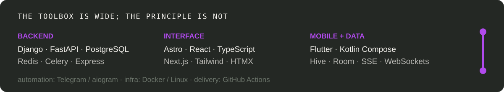

<p align="center">
  
</p>

I build products where the difficult part is not a single screen or endpoint, but keeping the whole thing true: the state, the fallback, the operator workflow, and the user-facing surface.

My work moves between Django and FastAPI backends, Astro and React interfaces, Flutter and Kotlin apps, Telegram automation, and the infrastructure that makes them meet.

<p align="center"></p>

## Work that has to hold together

### [Burgut Cargo](https://github.com/jamshid-muxsinov/burgut-cargo)

Cargo operations, public tracking, warehouses, trucks, Excel, realtime updates, and a Telegram bot all read from one shared state. The useful detail is the lifecycle: every status has to survive the trip from an internal operator to a customer-facing update.

`Django` `DRF` `PostgreSQL` `Redis` `Celery` `aiogram`

### Generator Store

An industrial RU/UZ catalog with an Astro SSR storefront on top of a Django/DRF core. CMS, categories, product pages, cart, and lead paths are allowed to fail independently, so one dead API does not turn the whole storefront into a blank page.

`Astro` `Preact` `Tailwind` `Django` `DRF` `PostgreSQL`

### AutoWash Pass

One timed wash session, two Android roles. A client creates a rotating QR, a physical terminal scans it, and FastAPI keeps the subscription and both clocks aligned. The interesting work is the protocol between devices, not the QR itself.

`FastAPI` `SQLAlchemy` `Kotlin Compose` `SSE` `FCM`

### Wearframe

A garment-image workflow for sellers and operators. Generation jobs expose live status, persist their artifacts, and have a provider fallback instead of pretending an AI provider is a reliable dependency.

`React` `TypeScript` `FastAPI` `PostgreSQL` `MinIO` `Redis`

### DocWeave

A local-first Markdown workspace where the live draft is provisional and HTTP Save is authoritative. Permissions, uploads, versions, export, and presence are built around that distinction.

`Django` `Channels` `Redis` `PostgreSQL`

<p align="center"></p>

## The rest of the bench

| Project | What it explores | Stack |
| --- | --- | --- |
| **Exam Forge** | Offline exam prep from the `.txt` files students already have | `Flutter` `Dart` `Hive` |
| **INN Report** | Legacy `.xls` import through a native Android bridge, then XLSX output | `Flutter` `Kotlin` `Apache POI` |
| **WeConstruct CRM** | Bilingual public site and construction operations on one core | `FastAPI` `PostgreSQL` `Redis` |
| **Sorex Logistics** | Role-heavy logistics admin, imports, exports, live notifications, and bot surfaces | `Django` `Channels` `Celery` `aiogram` |
| **Logistics Sim** | Teacher/student scenarios with realtime events and takeover flows | `Next.js` `Express` `Prisma` `Socket.IO` |
| **FlowMusic** | Normalising local tracks against several remote sources | `Kotlin` `Compose` `Room` `Media3` |
| **Telegram Video Downloader** | A downloader with explicit proxy, cookies, size, region, and cleanup paths | `Python` `aiogram` `yt-dlp` `ffmpeg` |
| **Consultation Forwarder** | Website lead intake with a Telegram claim action | `FastAPI` `aiogram` |
| **FAT32 Lab** | File operations against an actual mounted FAT image | `C` `shell` |

The smaller studies stay visible because they show the way I learn: through interfaces, protocols, imports, state transitions, and a lot of deliberate second passes.

<p align="center"></p>

## How I tend to work

```text
model the state  →  find the awkward boundary  →  make the surfaces agree
       ↓                    ↓                             ↓
 database + events     fallbacks + failure paths      web + mobile + bots
```

I care about the part after the happy path: stale data, interrupted uploads, device disagreement, legacy files, permissions, and the operator who still has to get the job done.

<p align="center"></p>

<p align="center">
  <a href="https://t.me/tasheet"></a>
  <a href="mailto:jmuxsinovjj@gmail.com"></a>
  <a href="https://github.com/jamshid-muxsinov"></a>
</p>

<p align="center"><sub>Built for the whole loop, especially the awkward part.</sub></p>
